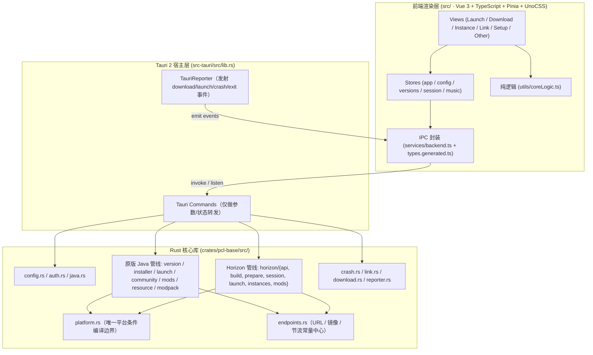
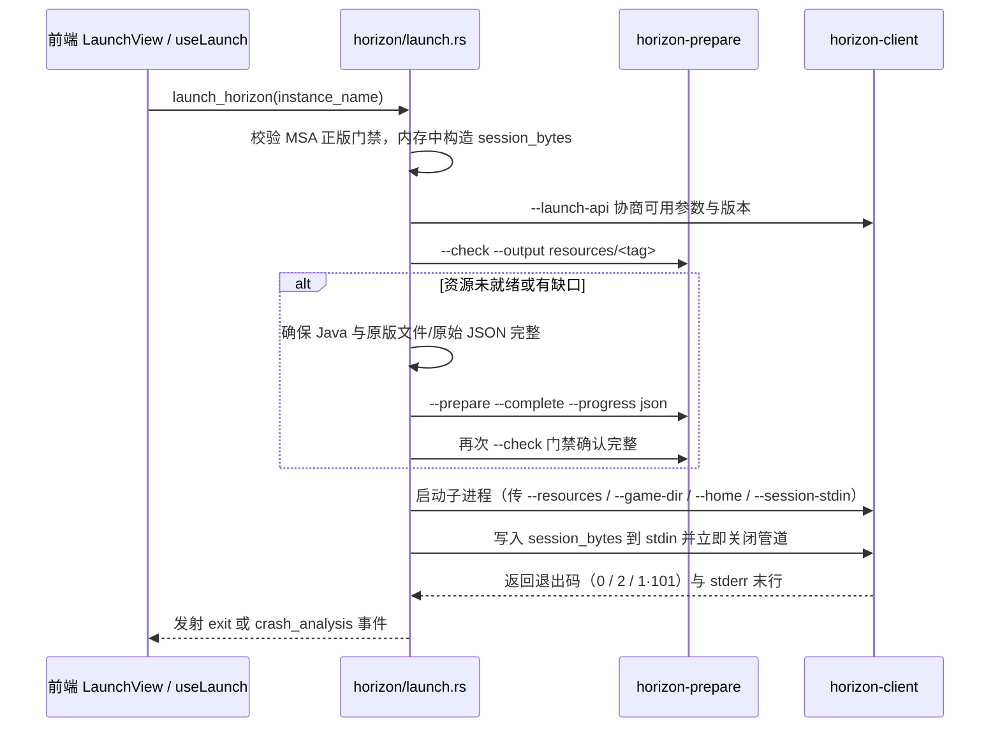

# Pure Build Launcher 架构文档

本文档描述 Pure Build Launcher（版本 `0.1.9`）的分层结构、模块职责、关键数据流与测试体系，覆盖 **原版 - Java** 与 **Horizon - Rust** 双生态启动管线。

---

## 1. 总体分层

仓库采用 Cargo Workspace + Vite/Vue 3 单体桌面应用布局，严格区分展示层、宿主胶水层与核心业务库：



### 设计约束
- **唯一平台边界**：跨操作系统差异（`#[cfg(target_os = ...)]`、默认游戏目录、Java 候选搜索路径、打开文件夹/链接、进程强杀、开服脚本生成）集中收敛于 `crates/pcl-base/src/platform.rs`。
- **端点集中管理**：官方源、镜像地址、请求间隔控制与公开 OAuth Client ID 统一定义在 `crates/pcl-base/src/endpoints.rs`。
- **凭据不进 `localStorage`**：登录 Profile 与 `access_token` 由 Rust 侧持久化至应用配置目录；Horizon 会话仅在内存中组装并经标准输入（`--session-stdin`）一次性写入游戏进程。
- **反硬编码**：Horizon 的兼容 Minecraft 版本、Java 主版本、`content` 能力清单及命令行选项全部在运行时通过 `--launch-api` 协商取得，不写死具体版本号。

---

## 2. 目录与模块划分

### 2.1 前端 (`src/`)

| 目录 / 文件 | 职责 |
|---|---|
| `views/` | 一级功能页面：`LaunchView.vue`（双布局启动页）、`DownloadView.vue`（双生态下载中心）、`InstanceView.vue`（实例模组/资源/存档与整合包管理）、`LinkView.vue`（局域网联机扫码与房间广播）、`SetupView.vue`（全局设置与测速/清缓存）、`OtherView.vue` |
| `components/launch/` | 经典与现代双启动布局（`LaunchClassicLayout.vue`、`LaunchModernLayout.vue`）、Java 运行时选择（`JavaSelectPanel.vue`）、Java 与 Horizon 实例切换器（`VersionPicker.vue`） |
| `components/download/` | 原版版本中心（`GameVersionCenter.vue`、`InstallConfigPanel.vue`、`LoaderCard.vue`、`ChangelogModal.vue`）、Modrinth 浏览器（`ModrinthBrowser.vue`）、Horizon 构建中心（`HorizonDownloadCenter.vue`）、Horizon 扩展仓库（`HorizonContentPanel.vue`）与行内进度条（`InlineProgress.vue`） |
| `components/auth/` / `components/music/` / `components/base/` | 登录弹窗（`LoginModal.vue`）、内置音乐控制栏（`MusicPlayerBar.vue`）、崩溃弹窗（`CrashDialog.vue`）及基础控件（`MyButton.vue`、`MyCard.vue`、`MyHint.vue`、`MyListItem.vue`、`PclIcon.vue`） |
| `stores/` | Pinia 状态管理：`app.ts` 统一聚合 `config.ts`（配置与应用参数）、`versions.ts`（Java 版本、Horizon 构建/实例状态与更新检查）、`session.ts`（登录态、任务与全局通知）和 `music.ts`（音频播放列表与音效参数） |
| `composables/useLaunch.ts` | 封装 Java 与 Horizon 的统一启动入口、进度事件订阅、进程退出/崩溃监听与强杀控制 |
| `services/` | `backend.ts` 封装全部 Tauri `invoke` 与事件监听；`types.generated.ts` 由 `ts-rs` 导出并受单测一致性校验；`audioEngine.ts` 实现基于 Web Audio API 的多段均衡器与淡入淡出 |
| `utils/coreLogic.ts` | 与 UI 解耦的纯函数（选中版本/实例修剪、MSA 账号门禁校验、聚焦刷新节流、音频列表过滤），配套 Vitest 单测 |

### 2.2 Tauri 宿主层 (`src-tauri/`)

- `src-tauri/src/lib.rs`：初始化日志与对话框插件、注入应用配置目录至 `ConfigManager`、实现 `ProgressReporter` 到 Tauri 事件总线（`download_progress`、`launch_progress`、`game_crash`、`game_exit_normal`）的桥接，并对外注册 Tauri 命令。
- `src-tauri/tauri.conf.json`：定义应用标识、窗口默认外观（含跨平台标题栏/无边框配置）及打包分发产物目标。

### 2.3 Rust 核心库 (`crates/pcl-base/src/`)

#### 基础设施与基础能力
- `platform.rs`：系统与架构映射（`mc_os_name`、`mc_os_arch`）、默认路径推导、Java 搜索目录与可执行名、打开文件夹/URL、杀进程、服务端脚本生成及 Horizon 平台资产命名。
- `endpoints.rs`：Mojang/BMCLAPI/Modrinth/Fabric/Forge/NeoForge/OptiFine/GitHub Releases/Horizon Mod Index 端点、并发与节流参数、微软登录端点常量。
- `config.rs`：`AppConfig` 与 `UserProfile`（凭据文件 `pcl_credentials.json`）的读取、回退与保存。
- `auth.rs`：微软 OAuth 设备码登录（Device Code → MS Token → XBL → XSTS → MC Token → Profile）与 Yggdrasil 外置登录。
- `java.rs`：扫描本机 JDK/JRE（Windows 注册表与常见路径、macOS `/usr/libexec/java_home` 与 Homebrew、Linux 常见路径与 PATH/JAVA_HOME），识别 `x64` / `arm64` 架构并按需下载 Temurin 运行时。
- `crash.rs` / `link.rs` / `reporter.rs`：游戏崩溃日志分析、局域网多人游戏广播发现与 `PCL2-LINK-` / `PCL2-HOST-` 邀请码解析、`ProgressReporter` 异步进度抽象。

#### 原版 - Java 管线
- `version.rs`：`VersionScanner` 扫描 `versions/<id>`、解析继承链与所需 Java 主版本、通过 `is_version_isolated` / `resolve_game_dir` 统一决策隔离目录（`versions/<id>`）或共享根目录（`<game_dir>`），以及提供边界校验安全的 `delete_version`。
- `installer/`：版本与加载器安装模块群——`libraries.rs`（按 Mojang rules/classifiers 过滤平台依赖）、`download.rs`（校验与断点重试下载）、`verify.rs`（SHA-1/大小校验与防篡改）、`merge.rs`（原版与加载器 JSON 合并）、`forge.rs` / `optifine.rs`（加载器安装器执行与结果融合）、`server.rs`（下载官方服务端并生成开服脚本）。
- `launch/`：启动参数与进程托管——`args.rs`（解析 rules、替换参数模板、组装 JVM/游戏参数）、`natives.rs`（提取对应平台 natives 并过滤 `META-INF` 与签名）、`process.rs`（子进程启动、输出采集、退出码及崩溃回传）。
- `community.rs` / `mods.rs` / `resource.rs` / `modpack.rs`：Modrinth 社区资源搜索与安装（通过 `InstalledCommunitySnapshot` 结合 `.pcl_modrinth_installed.json` 与本地扫描识别已安装状态）、模组/光影/材质/存档扫描与切换、`.mrpack` 整合包导入导出（含防 zip-slip 路径组件校验）。

#### Horizon - Rust 管线 (`crates/pcl-base/src/horizon/`)
严格按官方 Launch API 契约划分单职责子模块：
- `api.rs`：执行 `horizon-client --launch-api` 与 `horizon-prepare --launch-api`，校验大版本兼容性并解析可用选项、Minecraft 钉子版本、Java 主版本与 `content` 能力声明。
- `build.rs`：查询 GitHub Releases（支持在 API 403/429 限流时自动回退 Atom 订阅与 `expanded_assets` 页面），下载对应平台构建包并执行 `SHA256SUMS` 与 Ed25519 签名验证，解压后执行首次协商并写入 `pbl-build.json`，支持 `nightly` 更新检测与绑定实例删除保护。
- `prepare.rs`：读取构建 `research-lock.json` 校验原版元数据 SHA-1（必要时从 Mojang 官方元数据恢复未经二次格式化的原始 JSON 字节），补齐自管 Java 与服务端 jar，调用 `horizon-prepare --prepare --progress json` 准备资源并执行前后 `--check` 门禁。
- `instances.rs`：管理独立实例注册表（`horizon/instances.json`）与实例生命周期（创建、校验合法名、安全删除）。
- `session.rs`：仅针对正版微软账号（`auth_type == "msa"`）在内存中序列化会话 JSON 字节，不提供任何落盘方法。
- `launch.rs`：按协商选项表组装参数，通过 `--session-stdin` 传递会话后立即关闭管道，托管进程并按协商退出码与 `crash_report_line` 上报结果。
- `mods.rs`：拉取并缓存 Horizon 官方扩展索引（`HORIZON_MOD_INDEX_URL`），依据协商得到的 `content` 能力过滤兼容项；校验 SHA-256 后将 `.hshader`、`.hmod`（同步写入 `horizon-mods.txt`）及材质包安全落盘至指定实例目录，并拦截需本地源码重编的 `.hnmod`。

---

## 3. 关键运行数据布局与启动流

### 3.1 磁盘数据布局 (`<game_dir>`)

```text
<game_dir>/
  versions/<id>/              # Java 版游戏版本（含 *.json / *.jar / natives；隔离版本另含 mods/saves/options.txt）
  libraries/ & assets/        # Java 版公共库与资源（同时作为 Horizon 首次准备的输入源）
  mods/ shaderpacks/ resourcepacks/ saves/   # Java 非隔离版本的通用共享目录
  horizon/
    builds/<tag>/             # 已验签解压的 Horizon 构建整体包与 pbl-build.json / server.jar
    resources/<tag>/          # 与构建一对一绑定的准备后资源
    instances.json            # Horizon 实例注册表
    instances/<name>/         # 每个 Horizon 实例独立 --game-dir 与 --home
      horizon-mods/           # 内容模组 (<id>.hmod) 与 horizon-mods.txt
      shaderpacks/            # Horizon 原生光影 (*.hshader)
      resourcepacks/          # 材质包 (*.zip)
      saves/ logs/ crash-reports/
    cache/                    # Horizon 官方扩展索引缓存 (horizon-mods-index.json)
```

### 3.2 Horizon 启动前检查与会话交付流



---

## 4. 前后端契约与验证体系

| 测试层级 | 命令 | 覆盖范围 |
|---|---|---|
| Rust 核心单元与集成测试 | `cargo test -p pcl-base` | 平台目录/架构映射、四平台 rules 与 classifier 矩阵、下载校验、Auth/Config 凭据往返、Version 删除边界、Modrinth 隔离与共享快照、Horizon 验签/协商/准备/会话/启动退出码/扩展过滤与安装边界 |
| 启动参数快照回归 | `cargo test -p pcl-base --test launch_snapshot_tests` | 1.21.1 Vanilla / Fabric / NeoForge 跨平台启动参数快照 |
| TS 类型契约检查 | `cargo test -p pcl-base --test type_export_tests` | 校验 `src/services/types.generated.ts` 与 Rust `#[derive(TS)]` 结构体完全一致 |
| 前端纯函数测试 | `npm test` | `tests/unit/coreLogic.test.ts`（Vitest） |
| 全量类型与编译检查 | `cargo check --workspace`、`npm run build` | Rust 工作空间与 `vue-tsc -b && vite build` 生产构建校验 |
